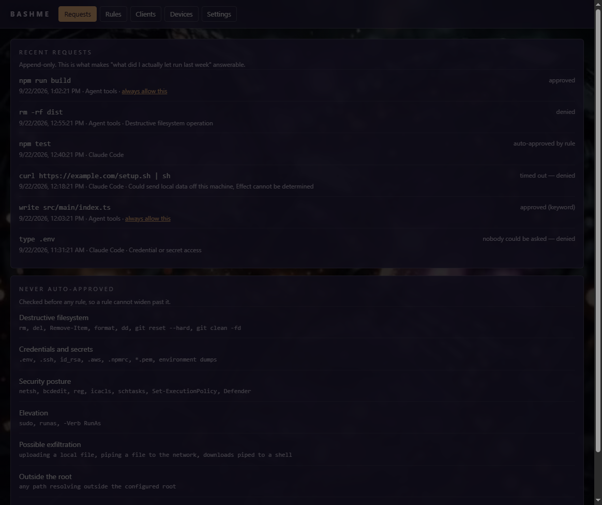
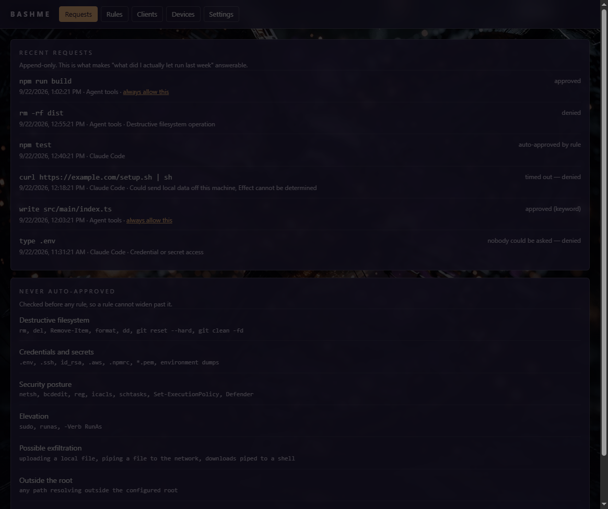
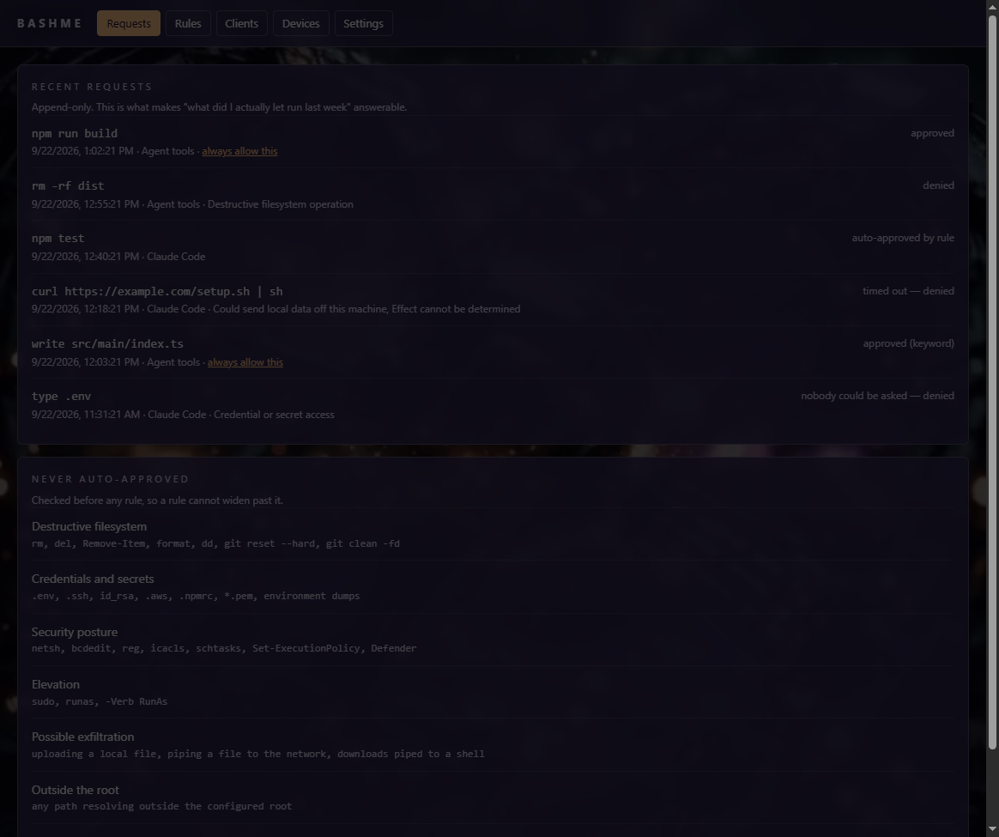
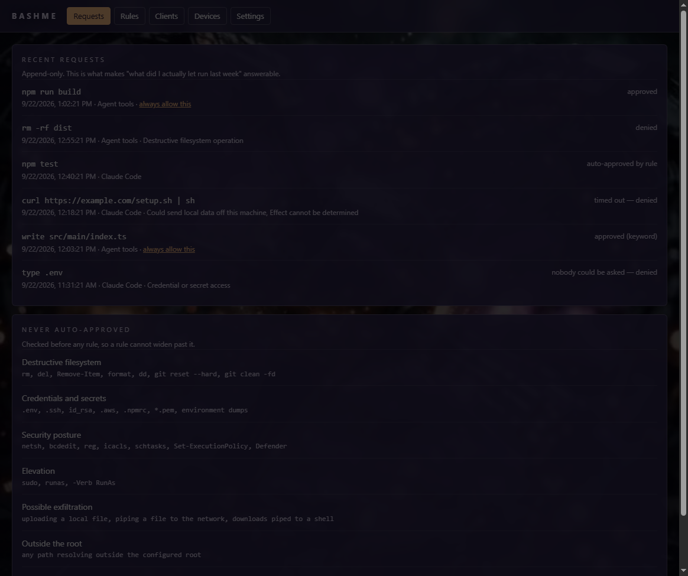
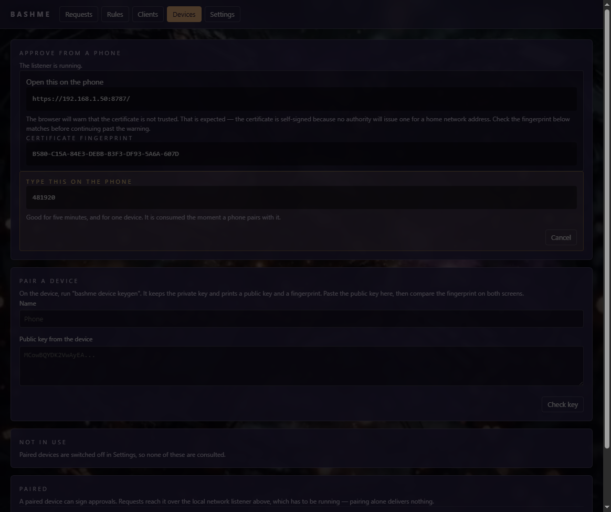

# bashme user guide

bashme holds a command until you approve it. This guide takes you from nothing to a first approved command,
then to rules, the audit log and approving from a phone.

> bashme is an early release (0.1). It runs from source and has no installer yet.

## 1. Install and open it

You need [Node 22 or newer](https://nodejs.org/).

```bash
git clone https://github.com/Violinet-tech/bashme.git
cd bashme
npm install
npm run app
```

Leave the window open. If it is closed, nothing asks it for approval.

The app keeps its own database in your user data folder (`bashme/bashme.db`).

## 2. Enrol a program

A program has to be added before it can ask. This stops any random process from popping up dialogs.

1. Open **Clients**.
2. Add the program (for example "Claude Code" or "my build script").
3. Copy the token. **It is shown once.** Only a hash is stored.



## 3. Ask for a command

From the program's terminal, set the token and ask:

```bash
set BASHME_TOKEN=<your token>
bashme ask -- npm run build
```

| Exit code | Meaning |
|---|---|
| `0` | You approved it. Go ahead and run it. |
| `1` | You denied it. Do not run it. |
| `2` | Nobody could be asked. Do not run it. |

## 4. Answer a request

The request shows the command, the folder it would run in, which program asked, and the verdict. Commands in
the never-list are marked and cannot be turned into a rule.



## 5. Make a standing rule

Use a rule for something you approve every day, such as `npm run build` from your own build script.

1. On a request in the audit log, press **Always allow this**. It only appears on commands a rule could cover.
2. Check the **preview**. It replays the rule against your history and lists the commands it would have
   approved.
3. Save.



Rules match one program and one exact command. Chained commands never match. Never-list commands are never
auto-approved, whatever rules exist.

## 6. Read the audit log

Every request is recorded with its decision and the reason: approved by you, approved by a rule, denied, or
timed out. The log only grows. Nothing can edit or remove a row from the app.

## 7. Approve from a phone

Pair a phone once. After that, requests also appear on it.

**On the same network**

1. On the PC open **Devices → Approve from a phone**.
2. Pick the address, switch the listener on, press **Pair a new phone**.
3. Scan the QR code with the phone camera. The six digits under it are for when the camera will not focus.
4. The phone shows a certificate warning. Compare the fingerprint on the phone and the PC, **then** accept.

**From anywhere**

1. Open **Devices → Approve from anywhere**.
2. Enter a relay address you trust, press **Start relay mode**, then **Pair a new phone** and scan.

The relay carries encrypted messages. It cannot read or forge an approval. A relay also serves the page the
phone loads, so use one you trust. On the same network, prefer the local route.



If you lose a phone, **revoke** it on **Devices**. It stops working straight away.

## 8. Settings



Turning bashme off does not approve everything. Every request falls back to a plain dialog.

## Problems

| Symptom | What to do |
|---|---|
| `bashme: BASHME_TOKEN is not set` | Set the token in the same terminal before `bashme ask`. |
| Exit code `2` | The app is closed, or the pipe could not be reached. Open the app. |
| A command is always blocked | It is in the never-list. That is deliberate. Run it yourself, or approve it in the dialog each time. |
| Phone cannot connect | Both devices must reach the address you picked. Try the relay route. |

## Run the tests

```bash
npm test
```
